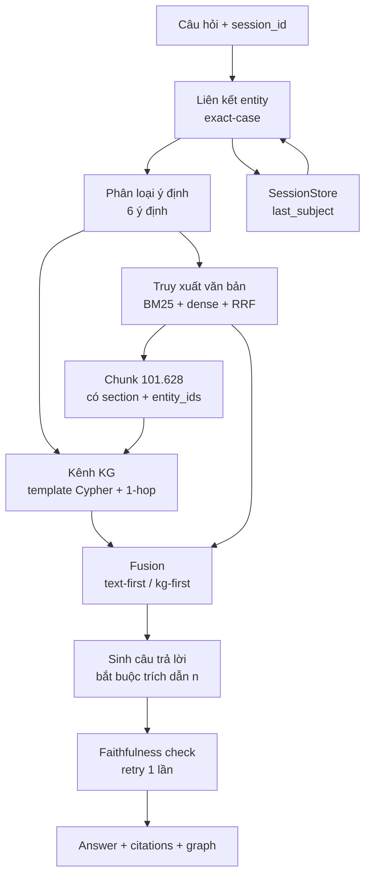

# Hệ thống hỏi đáp lịch sử Việt Nam — Vanilla RAG vs Hybrid GraphRAG

> Đồ án nhóm môn Xử lý ngôn ngữ tự nhiên (NLP).
> **Trục nghiên cứu (chốt 16/11/2026):** so sánh **Vanilla RAG (A)** với
> **Hybrid GraphRAG (B)** trên bộ câu hỏi lịch sử Việt Nam, kèm **ablation B−**
> (Hybrid nhưng tắt kênh Knowledge Graph) để chứng minh đóng góp đến từ
> *đồ thị* chứ không phải từ *prompt*.

---

## 1. Vì sao định hướng lại?

Bản đầu tiên của dự án là **Text-to-Cypher** (sinh Cypher từ câu hỏi rồi truy vấn
KG). Demo 16/11/2026 cho thấy 3 hạn chế cốt lõi:

| Triệu chứng | Nguyên nhân gốc đã xác minh |
|---|---|
| "Diễn biến trận Bạch Đằng" → không có chi tiết | Narrative **đã có sẵn** trong `doc_136933` (section `Diễn biến trận đánh`, 9 đoạn) nhưng **không có tầng truy xuất văn bản** |
| "Ai là **con** của Trần Nhân Tông?" không được | KG lưu quan hệ **một chiều** (`cha_cua`: subject = cha) ⇒ phải đảo mũi tên khi hỏi người **bị tác động** |
| "tiết → Tiết, đời → Đổi, bao → Bảo" | Lớp khớp entity **không kiểm tra chữ hoa** ⇒ "Đổi mới đất nước" khớp "Đổi Mới" |

⇒ **Luận điểm mới:** KG **không thay thế** RAG cho câu hỏi tự sự, mà **bổ sung**
cho RAG. Đó chính là câu hỏi nghiên cứu của đồ án.

---

## 2. Kiến trúc



### 3 arm so sánh

| Arm | Mô tả | Endpoint |
|---|---|---|
| **A** | Vanilla RAG — **chỉ** văn bản Wikipedia | `POST /api/ask/rag` |
| **B** | Hybrid GraphRAG — văn bản **+ KG** | `POST /api/ask/hybrid` (`use_graph=true`) |
| **B−** | Hybrid nhưng **tắt** kênh KG (ablation) | `POST /api/ask/hybrid` (`use_graph=false`) |

Cả 3 arm dùng **cùng một `Retriever`** (D-100) ⇒ chênh lệch đo được **không**
do retriever, mà do kênh đồ thị.

---

## 3. Số liệu

### 3.1. Quy mô dữ liệu

| Hạng mục | Giá trị |
|---|---|
| Bài Wikipedia | **2.441** |
| Đoạn văn (= chunk) | **101.628** |
| Câu | **186.960** |
| Triple KG (13 trường) | **13.379** |
| Node / cạnh trong Neo4j | **19.548 / 13.379** |
| Chunk đã embed (MiniLM-L12, 384-dim) | **65.608** |
| Bộ câu hỏi đánh giá | **247 câu / 5 dạng** |

### 3.2. Kết quả đánh giá A vs B vs B−

> Bộ benchmark: **247 câu** × 3 arm, chấm bằng LLM-judge (gộp 3 arm/câu, thứ tự arm
> hoán vị theo `qid`). Xem `reports/phase_16_report.md` (báo cáo đầy đủ) và
> `docs/10-nhat-ky/so-lieu/phase-16-eval-rag.json` (số liệu máy đọc được).

<!-- SỐ LIỆU_BENCHMARK: cập nhật bằng scripts/make_phase16_log.py -->

| Chỉ số | A — Vanilla RAG | B — Hybrid GraphRAG | B− — Hybrid không KG |
|---|---|---|---|
| correctness (0–2) | 1.1316 | 1.4342 | 1.1053 |
| correctness_rate | 0.5 | 0.6316 | 0.4868 |
| faithfulness (0–2) | 1.75 | 1.6316 | 1.7105 |
| faithfulness_rate | 0.8684 | 0.7895 | 0.8553 |
| citation_precision | 0.6776 | 0.7868 | 0.6842 |
| no_data_accuracy | — | — | — |
| latency p50 (ms) | 1593 | 1998 | 1835 |
| latency p95 (ms) | 12161 | 27272 | 14006 |
| context_tokens (TB) | 668 | 1813 | 690 |

**Công bằng của phép so sánh** (D-104 · D-108 · D-109):

| Rủi ro | Cách xử lý |
|---|---|
| Quota LLM free tier không đủ 988 lời gọi | Pool **đa provider** (Gemini + Groq) + cooldown 900 s |
| Arm A sinh bởi Gemini, arm B bởi Groq (confound model) | **Ghim 1 model/câu** cho cả 3 arm (seed `42:{qid}`) |
| Arm B− đọc lịch sử hội thoại của arm B | **Session tách theo arm** (`<session_id>__<arm>`) |
| Lỗi quota bị ghi điểm 0 | Đánh dấu `infrastructure_error` ⇒ **loại khỏi mẫu số** |
| Judge bỏ sót arm (JSON bị cắt token) | Retry với `max_tokens` lớn hơn + `scripts/rejudge_missing.py` |
| Model ghim mất khi mọi model cùng cooldown | `_pick()` **ghin lại** model thay thế + ghi model **thực sự** của từng arm |
| Câu có arm dùng khác model (confound) | Loại khỏi mẫu số, công khai `n_model_mismatch` |

### 3.3. Đo trước / sau (Phase 13 — sửa chất lượng)

| Vấn đề | Trước | Sau |
|---|---|---|
| False positive entity linking | "Đổi mới đất nước" → Đổi Mới; "Ông ấy" → George H. W. Bush | **0** / 12 ca regression |
| Alias toàn-chữ-thường trong chỉ mục | 211 | **0** |
| Câu hỏi chiều ngược ("con của X") | không trả lời được | **5/5** con Trần Nhân Tông đúng |
| Cạnh nhiễu KG lọt vào context | 23 cạnh ("Quốc lộ 14"…) | **0** |
| Câu hỏi không có entity cụ thể | trả 10 người ngẫu nhiên | `not_in_data` + hướng dẫn |

---

## 4. Bắt đầu nhanh

### 4.1. Yêu cầu

| Hạng mục | Yêu cầu |
|---|---|
| Python | 3.12 |
| Node | 20+ (khuyến nghị 24) |
| Docker | Docker Compose v2+ |
| RAM | ≥ 8 GB (embeddings ~2 GB) |
| GPU | **không** cần (toàn bộ chạy CPU) |

### 4.2. Cài đặt

```bash
# 1) Python
uv venv .venv && source .venv/bin/activate
uv pip install -r requirements.txt

# 2) Biến môi trường
cp .env.example .env      # điền GEMINI_API_KEY, GROQ_API_KEY, NEO4J_PASSWORD

# 3) Hạ tầng
docker compose up -d neo4j

# 4) Backend
uvicorn backend.app.main:app --reload --port 8000

# 5) Frontend (terminal khác)
cd frontend && npm install && npm run dev
```

### 4.3. Docker Compose (tất cả)

```bash
docker compose build
docker compose up -d
curl -s localhost:8000/api/health     # {"status":"ok","neo4j":"up"}
```

### 4.4. Chuẩn bị dữ liệu (nếu chạy từ máy sạch)

```bash
# 1) Tải + lọc dump Wikipedia
python -m src.preprocess.filter_articles
python -m src.preprocess.clean_text
python -m src.preprocess.split_sentences
python -m src.preprocess.parse_infobox

# 2) NER / coref / RE (nặng — chạy trên Kaggle GPU)
#    xem notebooks/kaggle/

# 3) Nạp KG
python scripts/load_neo4j.py --batch 1000
python scripts/validate_graph.py

# 4) Tầng truy xuất (Phase 14)
python -m src.qa.chunking                          # → data/interim/chunks.jsonl
python -m src.qa.embed_chunks --batch-size 64 --threads 8   # → chunk_embeddings.npy (~45 phút CPU)
python -m src.qa.retriever --build-index            # → bm25_index.npz
```

---

## 5. Kiểm thử

```bash
pytest -q tests/                   # unit + contract test
python scripts/validate_graph.py   # 13/13 PASS
python scripts/evaluate.py --all --out reports/   # đánh giá NER/RE/linking
```

### Đánh giá RAG (Phase 16)

```bash
# Sinh bộ câu hỏi (Wikidata — nguồn độc lập KG)
python -m src.evaluation.build_qa_set

# Chạy 3 arm + LLM-judge (pool đa provider + ghim model theo câu)
python -u -m src.evaluation.evaluate_rag \
  --qa-set data/eval/qa_rag_250.jsonl --arms A,B,B- \
  --gen-pool "gemini:gemini-3.1-flash-lite,gemini-3.1-flash-lite-preview,gemini-3-flash-preview;groq:openai/gpt-oss-120b,qwen/qwen3.8-27b,openai/gpt-oss-20b" \
  --judge-pool "gemini:gemini-3.1-flash-lite,gemini-3.1-flash-lite-preview,gemini-3-flash-preview;groq:openai/gpt-oss-120b,qwen/qwen3.8-27b" \
  --checkpoint data/eval/eval_rag_checkpoint.jsonl --resume \
  --infra-retries 3 --infra-retry-wait-s 45 --stamp phase16

# Sau khi chạy xong
python scripts/rejudge_missing.py         # chấm lại arm bị judge bỏ sót
python scripts/rebuild_phase16_report.py   # dựng lại số liệu từ checkpoint
python scripts/make_phase16_log.py --report reports/eval_rag_phase16_phase16.json
```

> ⚠️ **Quota LLM**: quota free tier **tính riêng theo model** (Gemini 500 RPD/model,
> Groq 200K TPD/model) ⇒ **không** dùng 1 provider ⇒ pool đa provider + cooldown.
> Xem D-103, D-104, D-108, D-109, D-111.

### Hỏi thử từng arm

```bash
# Vanilla RAG
curl -s localhost:8000/api/ask/rag \
  -H 'Content-Type: application/json' \
  -d '{"question":"diễn biến trận Bạch Đằng (1288)"}'

# Hybrid GraphRAG (có KG)
curl -s localhost:8000/api/ask/hybrid \
  -H 'Content-Type: application/json' \
  -d '{"question":"diễn biến trận Bạch Đằng (1288)","use_graph":true}'

# Ablation — Hybrid không KG
curl -s localhost:8000/api/ask/hybrid \
  -H 'Content-Type: application/json' \
  -d '{"question":"diễn biến trận Bạch Đằng (1288)","use_graph":false}'
```

---

## 6. API

| Method | Path | Mô tả |
|---|---|---|
| `GET` | `/api/health` | Trạng thái dịch vụ + Neo4j |
| `GET` | `/api/stats` | Thống kê KG |
| `POST` | `/api/ask` | **Text-to-Cypher** (tính năng phụ) |
| `POST` | `/api/ask/rag` | **Vanilla RAG** (arm A) |
| `POST` | `/api/ask/hybrid` | **Hybrid GraphRAG** (arm B / B−) |
| `GET` | `/api/session/{id}` | Lịch sử hội thoại |
| `GET` | `/api/search?q=` | Tìm entity |
| `GET` | `/api/entity/{id}` | Chi tiết entity |
| `GET` | `/api/graph/{id}?depth=1` | Đồ thị con |

---

## 7. Giao diện

- **Toggle A / B / B−** trên thanh công cụ chat — đổi arm giữa các lượt.
- **Trích dẫn click-to-source**: badge `[n]` mở đúng URL Wikipedia; phân biệt
  nguồn `Văn bản` (đoạn Wikipedia) và `KG` (triple đồ thị).
- **Đồ thị 1-hop** của các entity trong context (Cytoscape.js) — bấm cạnh để
  xem câu bằng chứng.
- **Hội thoại nhiều lượt**: "Ông ấy mất năm nào?" ⇒ tự kế thừa chủ thề lượt trước.

---

## 8. Tài liệu

| # | Tài liệu | Nội dung |
|---|---|---|
| — | [AGENTS.md](AGENTS.md) | **Hướng dẫn làm việc** — đọc file này trước tiên |
| — | [docs/CONTEXT.md](docs/CONTEXT.md) | **Context sống** — quyết định đã chốt, QID, model |
| — | [docs/PROGRESS.md](docs/PROGRESS.md) | Trạng thái từng phase, kết quả đo được |
| — | [docs/DECISIONS.md](docs/DECISIONS.md) | Nhật ký quyết định kiến trúc (D-001 → D-103) |
| — | [docs/GLOSSARY.md](docs/GLOSSARY.md) | Thuật ngữ Việt ↔ Anh ↔ trường dữ liệu |
| — | [docs/10-nhat-ky/](docs/10-nhat-ky/) | **Nhật ký triển khai chi tiết** theo phase (nguyên liệu báo cáo/slide) |
| 00 | [Tổng quan](docs/00-tong-quan.md) | Mục tiêu, phạm vi, nguyên tắc thiết kế, chỉ số |
| 01 | [Yêu cầu chức năng](docs/01-requirements-chuc-nang.md) | 9 module A–I kèm tiêu chí nghiệm thu |
| 02 | [Yêu cầu phi chức năng](docs/02-requirements-phi-chuc-nang.md) | Hiệu năng, độ chính xác, tin cậy, tái lập, bảo mật |
| 03 | [Kiến trúc hệ thống](docs/03-kien-truc-he-thong.md) | Offline/online, luồng dữ liệu, API, cấu trúc thư mục |
| 04 | [Schema KG](docs/04-schema-knowledge-graph.md) | Node, quan hệ, thuộc tính, Cypher DDL |
| 05 | [Dữ liệu và nguồn](docs/05-du-lieu-va-nguon.md) | Nguồn, giấy phép, QID đã verify, quota LLM |
| 07 | [Đánh giá và kiểm thử](docs/07-danh-gia-va-kiem-thu.md) | Chiến lược auto-gold, định nghĩa chỉ số, checklist |
| 08 | [Công cụ và môi trường](docs/08-cong-cu-va-moi-truong.md) | Công cụ, môi trường, quy trình Kaggle |
| 09 | [Kế hoạch thực thi](docs/09-ke-hoach-thuc-thien.md) | **Đặc tả phase 0–17**, mỗi phase tự kiểm thử được |
| — | [Hướng dẫn gán nhãn](docs/annotation-guidelines.md) | Quy tắc gán NER/RE |

---

## 9. Cấu trúc thư mục

```
docs/        đặc tả + context + nhật ký triển khai
configs/     *.yaml — nguồn sự thật cho cấu hình
src/
  preprocess/  ner/  coref/  re/  link/  graph/   pipeline offline
  qa/          chunking · embed_chunks · retriever · rag_answer
               graph_context · intent · fusion · conversation · hybrid
  evaluation/  build_qa_set · evaluate_rag
backend/    FastAPI: app/api (ask, ask_rag, ask_hybrid, lookup, stats, health)
frontend/   React + TS + Cytoscape (toggle A/B, citations, đồ thị 1-hop)
scripts/    CLI: download, load_neo4j, validate_graph, evaluate
notebooks/  Kaggle: train_ner, train_re, embed_entities, llm_extract
tests/      pytest
data/       raw, interim, processed, knowledge_base, eval  (gitignored)
models/     checkpoints  (gitignored)
reports/    kết quả đánh giá + báo cáo phase + deviations
```

---

## 10. Công nghệ

| Hạng mục | Chọn |
|---|---|
| Backend | FastAPI + Neo4j 5 Community (Docker) |
| Frontend | React 18 + TypeScript + Vite + Cytoscape.js |
| NER / RE | `vinai/phobert-base` (BIO / multi-label) |
| Embedding truy xuất | `sentence-transformers/paraphrase-multilingual-MiniLM-L12-v2` (384-dim) |
| Embedding entity linking | `BAAI/bge-m3` (1024-dim) |
| LLM bulk | Model mở lượng tử hóa trên Kaggle GPU (`Qwen/Qwen3-8B` 4-bit) — không tốn quota |
| LLM API | Gemini `gemini-3.5-flash-lite` (judge) + Groq `openai/gpt-oss-20b` (sinh câu trả lời) |
| Dữ liệu | Wikipedia tiếng Việt dump (CC BY-SA 4.0) + Wikidata (CC0) |

---

## 11. Giấy phép dữ liệu

- Wikipedia tiếng Việt — **CC BY-SA 4.0** (bắt buộc ghi phép quyền + liên kết nguồn).
- Wikidata — **CC0**.
