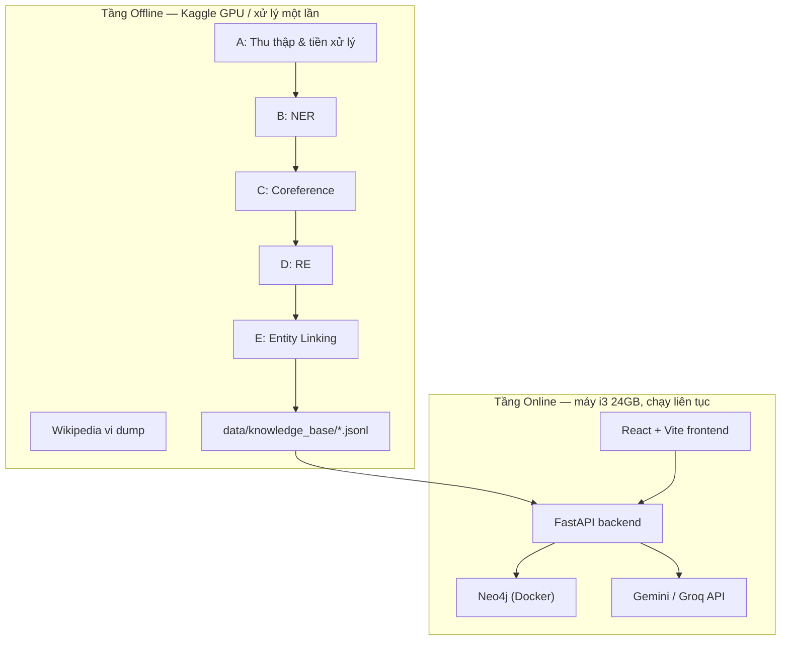
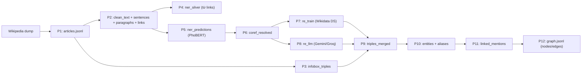
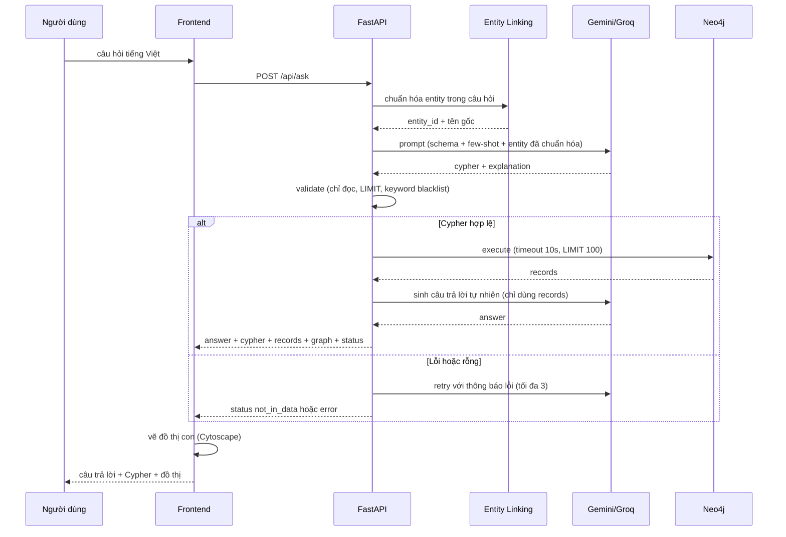

# 03 — Kiến trúc hệ thống

## 1. Tổng quan

Hệ thống chia thành **4 tầng** và **2 môi trường thực thi** tách biệt:



**Nguyên tắc tách lớp**: toàn bộ công việc nặng (fine-tune, LLM batch, embedding) nằm ở tầng Offline và ghi ra **artifact JSONL** ở `data/`. Tầng Online chỉ đọc artifact, tra cứu Neo4j, và gọi LLM API cho Text-to-Cypher. Nhờ vậy máy i3 không cần GPU, không cần mô hình lớn, và không cần tải lại dump.

---

## 2. Luồng dữ liệu Offline (chi tiết)



| Bước | Script (dự kiến) | Input | Output | Chạy ở đâu |
|---|---|---|---|---|
| P1 | `scripts/download_dump.py` | dump `viwiki` | `data/raw/viwiki-latest-pages-articles.xml.bz2` | máy / Kaggle |
| P2 | `src/preprocess/filter_articles.py` | dump | `data/interim/documents.jsonl` | máy / Kaggle CPU |
| P3 | `src/preprocess/clean_text.py` | documents | `documents.jsonl` (+ `clean_text`, `sentences`) | máy |
| P4 | `src/preprocess/parse_infobox.py` | documents | `data/interim/infobox_triples.jsonl` | máy |
| P5 | `src/ner/train_ner.py` (Kaggle) | `ner_silver.jsonl` | `models/ner/` | **Kaggle GPU** |
| P6 | `src/ner/infer_ner.py` | documents + model | `ner_predictions.jsonl` | Kaggle GPU / máy |
| P7 | `src/coref/resolve_coref.py` | ner_predictions | `coref_resolved.jsonl` | máy |
| P8 | `src/re/build_distant_supervision.py` | Wikidata SPARQL | `data/interim/wikidata_pairs.jsonl` | máy |
| P9 | `src/re/train_re.py` (Kaggle) | `re_train.jsonl` | `models/re/` | **Kaggle GPU** |
| P10 | `src/re/infer_re.py` | coref + model | `re_phobert.jsonl` | Kaggle GPU / máy |
| P11 | `src/re/infer_re_llm.py` | sentences | `re_llm.jsonl` | API (tập con ~1.500 câu) |
| P11b | `notebooks/kaggle/06_llm_extract_kaggle.ipynb` | sentences (toàn corpus) | `re_llm_kaggle.jsonl` | **Kaggle GPU** (model mở lượng tử hóa) |
| P12 | `src/link/build_aliases.py` | entities + Wikidata | `data/knowledge_base/entities.jsonl` | máy |
| P13 | `src/link/embed_entities.py` (Kaggle) | entities | `data/knowledge_base/entity_embeddings.npy` | **Kaggle GPU** |
| P14 | `src/link/link_mentions.py` | mentions | `linked_mentions.jsonl` | máy (CPU) |
| P15 | `src/graph/build_graph.py` | triples + entities | `data/knowledge_base/graph.jsonl` | máy |
| P16 | `scripts/load_neo4j.py` | graph.jsonl | Neo4j | máy |

> Tên script là **dự kiến**; tài liệu này là đặc tả, mã sẽ được viết ở giai đoạn sau.

---

## 3. Luồng trực tuyến (Text-to-Cypher)



**Điểm thiết kế quan trọng**
- Entity linking trên câu hỏi dùng **từ điển alias của KG** (Module E) → nhất quán với node trong DB, không phụ thuộc LLM nhớ tên.
- Validator Cypher là lớp bảo vệ thứ hai sau tài khoản DB chỉ đọc.
- Retry chỉ khi lỗi cú pháp/rỗng; không retry khi truy vấn hợp lệ và rỗng ở lần cuối → trả "không có trong dữ liệu" (G8).
- LLM chỉ được dùng để **diễn đạt**, không được bịa dữ liệu: prompt ràng buộc chỉ dùng thông tin trong `records`.

---

## 4. Cấu trúc thư mục dự kiến

```
vhgr_pj/
├── docs/                      # tài liệu đề tài
├── configs/
│   ├── default.yaml           # seed, đường dẫn, ngưỡng
│   ├── pipeline.yaml          # cờ bật/tắt từng module A-I
│   ├── llm.yaml               # provider, model, retry, quota
│   └── neo4j.yaml             # URI, user, db, batch size
├── src/
│   ├── preprocess/            # Module A
│   ├── ner/                   # Module B
│   ├── coref/                 # Module C
│   ├── re/                    # Module D
│   ├── link/                  # Module E
│   ├── graph/                 # Module F (build graph, schema, loader)
│   ├── qa/                    # Module G (text-to-cypher)
│   ├── evaluation/            # Module I (metrics)
│   └── common/                # config, logging, seed, normalize, schemas
├── backend/                   # FastAPI
│   ├── app/
│   │   ├── main.py
│   │   ├── api/               # routers: ask, search, graph, admin
│   │   ├── services/          # neo4j_client, llm_client, entity_linker
│   │   ├── schemas/           # pydantic models
│   │   └── prompts/           # .txt templates cho Text-to-Cypher
│   └── requirements.txt
├── frontend/                  # React + Vite + TypeScript
│   ├── src/
│   │   ├── components/        # Chat, GraphView, EntityCard, EvidencePanel, Timeline, FamilyTree, Filters
│   │   ├── pages/             # Home, Stats, Admin
│   │   ├── api/               # client.ts
│   │   └── types/
│   ├── package.json
│   └── vite.config.ts
├── scripts/                   # CLI: download, run_pipeline, evaluate, load_neo4j, export_graph
├── notebooks/                 # Kaggle notebooks (train_ner, train_re, embed_entities)
├── data/
│   ├── raw/                   # dump (gitignored)
│   ├── interim/               # artifact từng bước (gitignored)
│   ├── processed/             # documents.jsonl
│   └── knowledge_base/        # entities.jsonl, graph.jsonl, embeddings.npy
├── models/                    # checkpoints (gitignored)
├── reports/                   # kết quả đánh giá, bảng so sánh
├── logs/                      # log chạy (gitignored)
├── docker-compose.yml         # Neo4j (+ có thể backend/frontend)
├── .env.example
├── .gitignore
└── README.md
```

---

## 5. Giao diện API (Backend)

Tất cả endpoint dưới `/api`. Response luôn kèm `status` để frontend phân biệt `found` / `not_in_data` / `error`.

### 5.1 `POST /api/ask` — hỏi đáp Text-to-Cypher (Module G)

**Request**
```json
{
  "question": "Vợ của vua Lê Thái Tổ là con của ai?",
  "session_id": "s-abc123",
  "include_graph": true,
  "max_hops": 2
}
```

**Response 200**
```json
{
  "status": "found",
  "answer": "Vợ của Lê Thái Tổ là Lê Thị Ngọc, con của Lê Khánh Dư.",
  "cypher": "MATCH (p:Person {entity_id:$a})-[:vo_cua]->(s:Person) MATCH (s)-[:cha_cua]->(f:Person) RETURN s, f",
  "entities": [
    {"entity_id": "ent_le_loi_1a2b3c4d", "surface": "Lê Thái Tổ", "canonical_name": "Lê Lợi", "type": "Person"}
  ],
  "records": [{"s.name": "Lê Thị Ngọc", "f.name": "Lê Khánh Dư"}],
  "graph": {
    "nodes": [{"id": "ent_le_loi_1a2b3c4d", "label": "Person", "name": "Lê Lợi", "verified": true}],
    "edges": [{"source": "ent_le_loi_1a2b3c4d", "target": "ent_le_thi_ngoc_xxx", "relation": "vo_cua", "confidence": 0.95, "evidence_sentence": "...", "source_url": "..."}]
  },
  "retries": 1,
  "elapsed_ms": 2140
}
```

**Response khi không có dữ liệu**
```json
{ "status": "not_in_data", "answer": "Không có trong dữ liệu.", "cypher": null, "records": [], "graph": {"nodes": [], "edges": []} }
```

**Response khi lỗi**
```json
{ "status": "error", "answer": "Xảy ra lỗi khi truy vấn. Vui lòng thử lại.", "error_code": "CYPHER_TIMEOUT", "cypher": null, "records": [], "graph": {"nodes": [], "edges": []} }
```

### 5.2 `GET /api/search?q=...&type=Person&limit=10` — autocomplete (H9)

```json
{
  "status": "found",
  "results": [
    {"entity_id": "ent_le_loi_1a2b3c4d", "name": "Lê Lợi", "type": "Person",
     "aliases": ["Lê Thái Tổ", "Bình Định Vương"], "birth_year": 1385, "death_year": 1433,
     "wiki_url": "https://vi.wikipedia.org/wiki/Lê_Lợi"}
  ]
}
```

### 5.3 `GET /api/graph/{entity_id}?hops=2&relations=...&dynasty=...&year_from=...&year_to=...` — đồ thị con (H2, H3, H5)

Trả về `nodes`/`edges` đã lọc. Edge luôn kèm bằng chứng.

### 5.4 `GET /api/entity/{entity_id}` — thẻ thông tin (H3)

### 5.5 `GET /api/stats` — thống kê KG (I1)

### 5.6 `GET /api/stats/conflicts` — nhóm xung đột (D6)

### 5.7 Endpoint admin
- `POST /api/admin/triples/review` — duyệt/sửa/xóa triple (I2)
- `POST /api/admin/entities/merge` — gộp entity (E6)

---

## 6. Cấu hình

`configs/default.yaml` (nội dung kỳ vọng):

```yaml
seed: 42
paths:
  raw_dir: data/raw
  interim_dir: data/interim
  processed_dir: data/processed
  kb_dir: data/knowledge_base
  models_dir: models
  reports_dir: reports

neo4j:
  uri: bolt://localhost:7687
  user: neo4j
  password: ${NEO4J_PASSWORD}
  database: neo4j
  batch_size: 500
  read_only_user: reader

llm:
  provider: gemini          # gemini | groq | openai-compatible
  model: gemini-3.5-flash-lite     # 15 RPM / 500 RPD free tier
  fallback_provider: groq
  fallback_model: openai/gpt-oss-20b   # 30 RPM / 1000 RPD free tier
  api_key_env: GEMINI_API_KEY
  fallback_api_key_env: GROQ_API_KEY
  temperature: 0.0
  max_retries: 3
  timeout_s: 60
  rate_limit_per_min: 15
  # Lưu ý: gemini-2.0-flash (mất quota free) và gemini-2.5-* (deprecated) không dùng được.
  # Groq đã retire llama-3.1-8b-instant và llama-3.3-70b-versatile (16/08/2026).
  # Trích xuất LLM trên TOÀN BỘ corpus chạy bằng model mở lượng tử hóa trên Kaggle GPU
  # (src/re/infer_re_llm_kaggle.py) — không tốn quota. API free tier chỉ dùng cho:
  #   1) baseline đối chiếu trên tập con ~1.500 câu
  #   2) Text-to-Cypher lúc demo
  #   3) LLM-judge cho đánh giá faithfulness
  bulk_extraction:
    method: kaggle_gpu
    model: Qwen/Qwen3-8B
    quantization: 4bit
    chunk_sentences_per_request: 15

ner:
  model_name: vinai/phobert-base
  max_len: 256
  batch_size: 32
  silver_link_min_anchor_match: 0.8

re:
  model_name: vinai/phobert-base
  marker_style: typed_markers
  max_len: 256
  batch_size: 32
  relation_types: [cha_cua, me_cua, vo_cua, chong_cua, anh_em_cua, thuoc_trieu_dai, ke_vi, giu_chuc_vu, lap_ra, chi_huy_tran, tham_gia_tran, danh_bai, dien_ra_tai, sinh_tai, mat_tai, sinh_nam, mat_nam, dong_doi_tai]

link:
  embedding_model: BAAI/bge-m3
  dim: 1024
  top_k: 20
  context_weight: {alias: 1.0, context: 0.6, temporal: 0.5, dynasty: 0.5, type: 0.4, freq: 0.2}

pipeline:
  stages: [A, B, C, D, E, F]
  skip: []
  entities_from: [infobox, wikidata]
```

---

## 7. LLM adapter (Gemini + Groq)

Vì chỉ dùng free tier, adapter phải:
- **Trừu tượng hoá provider**: interface chung `LLMClient.complete(messages, system, temperature, max_tokens) -> str`.
- **Fallback tự động**: Gemini hết quota/429 → chuyển sang Groq; ghi log cảnh báo.
- **Rate limiting**: bộ giới hạn tốc độ theo provider (Gemini `gemini-3.5-flash-lite` 15 RPM / 500 RPD; Groq 30 RPM / 1.000 RPD).
- **Retry**: exponential backoff, tối đa 3 lần, chỉ retry lỗi 429/5xx.
- **Cache**: cache theo hash `(model, prompt, params)` lưu `data/interim/llm_cache.sqlite` (tránh gọi lại, tiết kiệm quota).
- **JSON mode**: ép output là JSON khi prompt yêu cầu; parse lỗi → 1 lần retry với "trả về JSON hợp lệ".
- **Chi phí**: theo dõi số request/ngày và số token, in cảnh báo khi vượt ngưỡng.

**Giới hạn quota và cách vượt qua:** tổng quota free ≈ 3.500 request/ngày, trong khi corpus có 150.000–400.000 câu. Vì vậy **LLM không dùng để trích xuất toàn bộ corpus qua API**. Tách rõ 2 đường:

| Đường | Công cụ | Phạm vi | Quota |
|---|---|---|---|
| **Bulk** | Model mở lượng tử hóa trên **Kaggle GPU** (`Qwen/Qwen3-8B` 4-bit hoặc `openai/gpt-oss-20b`) | toàn corpus | Không tốn quota API |
| **API** | Gemini/Groq theo adapter | baseline tập con ~1.500 câu · Text-to-Cypher lúc demo · LLM-judge | ~3.500 req/ngày |

Cả hai đường ghi ra cùng một format (`method="llm"`), nên `merge_triples` không cần biết triple đến từ đâu.

**Cấu hình model đã verify (11/2026)** — xem [05-du-lieu-va-nguon.md](05-du-lieu-va-nguon.md#84-mô-hình-llm-free-tier-tính-đến-112026).

---

## 8. Thành phần frontend

| Trang | Module | Nội dung |
|---|---|---|
| `/` (Home) | H1, H2, H3, H4, H9, H10 | Chat + đồ thị con + panel bằng chứng + ô tìm kiếm + câu hỏi gợi ý |
| `/entity/{id}` | H3 | Thẻ thông tin đầy đủ |
| `/timeline` | H7 | Timeline sự kiện |
| `/family/{id}` | H6 | Cây gia phả |
| `/stats` | I1 | Thống kê KG |
| `/admin` | I2, E6 | Duyệt triple, gợi ý gộp entity |

**Thư viện frontend**: React 18 + TypeScript + Vite + Cytoscape.js (+ `cytoscape-dagre` cho cây gia phả) + `react-leaflet` (H8) + Recharts (I1) + TanStack Query.

---

## 9. Nguyên tắc thiết kế đã chốt

| # | Nguyên tắc | Hệ quả thiết kế |
|---|---|---|
| 1 | Tách offline/online | Không cần GPU lúc demo; artifact JSONL là hợp đồng giữa 2 tầng |
| 2 | Bằng chứng bắt buộc | `evidence_sentence` là trường bắt buộc ở mọi nơi tạo triple |
| 3 | Schema đóng | Tập quan hệ là enum dùng chung cho train, prompt, validator |
| 4 | Idempotent | `MERGE` theo `entity_id`; nạp lại không đổi số node/cạnh |
| 5 | Idempotent LLM | Cache SQLite + checkpoint |
| 6 | Chỉ đọc | Validator tĩnh + session Neo4j `READ_ACCESS` (server từ chối ghi) + timeout + LIMIT |
| 7 | Cấu hình tập trung | `configs/*.yaml`, secret qua biến môi trường |
| 8 | Ngôn ngữ | UI và prompt bằng tiếng Việt; tài liệu tiếng Việt |
