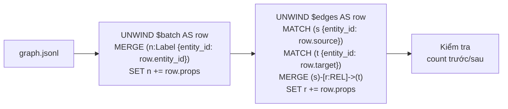

# 04 — Schema Knowledge Graph (Neo4j)

Tài liệu này là **hợp đồng dữ liệu** giữa pipeline, Neo4j, prompt LLM và UI. Mọi tên node/edge/property ở đây phải được dùng nhất quán ở tất cả nơi.

---

## 1. Nhãn node

| Nhãn | Ý nghĩa | Ví dụ |
|---|---|---|
| `Person` | Nhân vật lịch sử | Lê Lợi |
| `Dynasty` | Triều đại / dòng họ | nhà Trần |
| `Event` | Sự kiện, trận đánh | Trận Bạch Đằng (1284) |
| `Place` | Địa danh | Hoa Lư |
| `Title` | Miếu hiệu, thụy hiệu, niên hiệu, chức vụ | Lê Thái Tổ, Tể tướng quân |
| `Article` | Bài Wikipedia nguồn | "Lê Lợi" |
| `Conflict` | Nhóm triple mâu thuẫn (D6) | — |

Quy ước: một entity có **nhãn chính** theo loại, nhưng cũng có thể mang nhãn phụ khi thực chất hỗn hợp (ví dụ một `Event` vừa là trận đánh vừa là sự kiện) — quy tắc: **một node có đúng một nhãn chính**, các nhãn khác là nhãn bổ trợ, được đếm riêng.

---

## 2. Thuộc tính node

### 2.1 Thuộc tính chung (bắt buộc với mọi node)

| Property | Kiểu | Ý nghĩa | Ghi chú |
|---|---|---|---|
| `entity_id` | string | ID nội bộ ổn định | `ent_<slug>_<hash8>`, unique |
| `name` | string | Tên chuẩn (tên bài Wikipedia) | |
| `name_normalized` | string | Tên chuẩn hóa để tra cứu | bỏ dấu, lowercase, bỏ dấu câu |
| `type` | string | Loại entity | `person` / `dynasty` / `event` / `place` / `title` |
| `aliases` | list[string] | Tất cả tên gọi khác | từ E1 |
| `aliases_normalized` | list[string] | Bản chuẩn hóa của aliases | phục vụ index |
| `description` | string | Mô tả ngắn | lấy từ đoạn đầu bài |
| `wiki_url` | string | Link bài Wikipedia | **bắt buộc** (CC BY-SA) |
| `wikidata_qid` | string | QID nếu có | null nếu chưa ánh xạ |
| `verified` | boolean | Đã được xác minh | false cho node NIL |
| `mention_count` | int | Số lần được nhắc trong corpus | |
| `source_method` | string | Nguồn tạo node | `infobox` / `wikidata` / `link` / `llm` / `nil` |
| `created_at` | datetime | Thời điểm tạo | ISO-8601 |

### 2.2 Thuộc tính riêng theo loại

**`Person`**
| Property | Kiểu | Nguồn |
|---|---|---|
| `birth_year` | int | infobox `sinh`, Wikidata `P569` |
| `death_year` | int | infobox `mất`, Wikidata `P570` |
| `birth_date` | string (ISO) | ngày đầy đủ nếu có |
| `death_date` | string (ISO) | |
| `birth_place` | string (tên) | |
| `death_place` | string (tên) | |
| `gender` | string | `nam` / `nữ` / `khong_rõ` |
| `dynasty` | string (tên) | triều đại |
| `reign_start` | int | năm đăng quang |
| `reign_end` | int | năm cuối cùng |
| `temple_name` | string | miếu hiệu |
| `posthumous_name` | string | thụy hiệu |
| `reign_title` | string | niên hiệu |
| `father_name` / `mother_name` | string | phục vụ hiển thị nhanh |
| `spouse_names` | list[string] | |
| `sibling_names` | list[string] | |
| `occupation` | string | chức vụ / nghề |
| `latitude` / `longitude` | float | nếu có (H8) |

**`Dynasty`**
| Property | Kiểu | Nguồn |
|---|---|---|
| `start_year` / `end_year` | int | |
| `capital` | string | thủ đô |
| `founder` | string | người sáng lập |
| `successor_dynasty` | string | triều đại kế tiếp |

**`Event`**
| Property | Kiểu | Nguồn |
|---|---|---|
| `year` | int | năm diễn ra |
| `start_date` / `end_date` | string (ISO) | nếu có |
| `location_name` | string | |
| `result` | string | kết quả |
| `participants` | list[string] | |
| `event_type` | string | `tran_danh` / `sukien` |

**`Place`**
| Property | Kiểu | Nguồn |
|---|---|---|
| `place_type` | string | `thành phố` / `sông` / `núi` / `tỉnh` / `làng` … |
| `latitude` / `longitude` | float | Wikidata `P625` |
| `region` | string | vùng miền |

**`Title`**
| Property | Kiểu | Nguồn |
|---|---|---|
| `title_type` | string | `mieu_hieu` / `thuy_hieu` / `nien_hieu` / `chuc_vu` |
| `holder` | string | người giữ chức (nếu xác định) |

**`Article`**
| Property | Kiểu | Nguồn |
|---|---|---|
| `page_id` | int | |
| `title` | string | |
| `url` | string | |
| `dump_version` | string | ngày dump |
| `num_sentences` | int | |

---

## 3. Quan hệ (edge)

### 3.1 Danh mục đầy đủ

| Quan hệ | Hướng | Nguồn→Đích | Ví dụ | Đối xứng |
|---|---|---|---|---|
| `cha_cua` | có hướng | con → cha | Lê Lợi → Lê Khánh Dư | không |
| `me_cua` | có hướng | con → mẹ | Lê Lợi → Lê Thị Ngọc | không |
| `vo_cua` | có hướng | (chồng) → vợ | Lê Lợi → Lê Thị Ngọc | không |
| `chong_cua` | có hướng | (vợ) → chồng | Lê Thị Ngọc → Lê Lợi | không |
| `anh_em_cua` | **đối xứng** | sibling ↔ sibling | Lê Thái Tổ ↔ Lê Nghiễn | **có** |
| `thuoc_trieu_dai` | có hướng | person/event → dynasty | Lê Lợi → nhà Lê | không |
| `ke_vi` | có hướng | predecessor → successor | Lê Lợi → Lê Thái Tông | không |
| `giu_chuc_vu` | có hướng | person → title | Lê Lợi → Thái tử | không |
| `lap_ra` | có hướng | person → dynasty/event | Lê Lợi → nhà Lê | không |
| `chi_huy_tran` | có hướng | person → event | Trần Hưng Đạo → Trận Bạch Đằng | không |
| `tham_gia_tran` | **đối xứng** | person ↔ event | Trần Hưng Đạo ↔ Trận Bạch Đằng | **có** |
| `danh_bai` | có hướng | winner → loser | Lê Lợi → nhà Minh | không |
| `dien_ra_tai` | có hướng | event → place | Trận Bạch Đằng → sông Hồng | không |
| `sinh_tai` | có hướng | person → place | Lê Lợi → Thanh Hóa | không |
| `mat_tai` | có hướng | person → place | Lê Lợi → thành Đông Quan | không |
| `sinh_nam` | có hướng | person → year | Lê Lợi → 1385 | không |
| `mat_nam` | có hướng | person → year | Lê Lợi → 1433 | không |
| `dong_doi_tai` | có hướng | dynasty → place | nhà Lê → Thăng Long | không |

> `sinh_nam` / `mat_nam` là **quan hệ tới giá trị số**. Trong Neo4j, để giữ mọi cạnh là quan hệ có kiểu, ta lưu giá trị năm dưới dạng **node `Year`** nội bộ hoặc dưới dạng property trên cạnh. **Quyết định:** dùng **property trên cạnh** (`birth_year`/`death_year`) làm giá trị chính, và `sinh_nam`/`mat_nam` là quan hệ tới node `Year` (label `Year`, property `value`) để vẫn truy vấn được bằng Cypher thuần. Xem [Schema Cypher](#5-schema-cypher).

### 3.2 Quy tắc bắt buộc

1. **Tên quan hệ là chuỗn hằng** dùng chung cho: tập huấn luyện RE, prompt LLM, validator Cypher, query frontend, tài liệu.
2. **Quan hệ đối xứng** khai báo trong hằng số `SYMMETRIC_RELATIONS = {"anh_em_cua", "tham_gia_tran"}`. Khi nạp: chỉ tạo **một** cạnh với orientation chuẩn (theo thứ tự `entity_id` tăng dần) → không sinh cạnh trùng.
3. **Cạnh có hướng** giữ nguyên hướng subject → object.
4. **Không quan hệ ngoài danh mục** được ghi vào KG. Triple với quan hệ lạ bị loại và đếm ở báo cáo.
5. **Cùng một cặp (subject, relation, object)** chỉ giữ **một** cạnh, ưu tiên bản có `confidence` cao nhất; các bản khác lưu vào `alt_evidence` (list) trên cạnh.

### 3.3 Thuộc tính cạnh

| Property | Kiểu | Bắt buộc | Ý nghĩa |
|---|---|---|---|
| `confidence` | float | ✅ | [0, 1] |
| `method` | string | ✅ | `infobox` / `distant_supervision` / `phobert_re` / `llm` / `rule` |
| `evidence_sentence` | string | ✅ | câu bằng chứng (nguyên văn) |
| `source_url` | string | ✅ | URL bài Wikipedia |
| `doc_id` | int | ✅ | page_id |
| `doc_title` | string | ✅ | |
| `sentence_id` | string | ✅ | |
| `alt_evidence` | list[dict] | ⬜ | các bằng chứng khác cho cùng triple |
| `start_year` | int | ⬜ | quan hệ có thời gian |
| `end_year` | int | ⬜ | |
| `start_date` / `end_date` | string (ISO) | ⬜ | |
| `created_at` | datetime | ✅ | |
| `conflict` | boolean | ⬜ | đánh dấu mâu thuẫn (D6) |

---

## 4. Ví dụ đồ thị con

```
(Lê Lợi:Person)
  ├─[:cha_cua {conf .95, evidence}]──> (Lê Khánh Dư:Person)
  ├─[:me_cua {conf .95}]────────────> (Lê Thị Ngọc:Person)
  ├─[:vo_cua {conf .95}]────────────> (Lê Thị Ngọc:Person)
  ├─[:anh_em_cua {conf .90}]────────> (Lê Nghiễn:Person)
  ├─[:thuoc_trieu_dai {conf .99}]────> (nhà Lê:Dynasty)
  ├─[:lap_ra {conf .99}]────────────> (nhà Lê:Dynasty)
  ├─[:ke_vi {conf .92, start_year 1428, end_year 1433}]──> (Lê Thái Tông:Person)
  ├─[:sinh_tai {conf .80}]──────────> (Thanh Hóa:Place)
  ├─[:mat_tai {conf .85}]───────────> (Đông Quan:Place)
  ├─[:sinh_nam {conf .99}]──────────> (1385:Year)
  ├─[:mat_nam {conf .99}]───────────> (1433:Year)
  └─[:giu_chuc_vu {conf .90}]───────> (Thái tử:Title)
```

---

## 5. Schema Cypher

```cypher
// ---- Constraints: entity_id duy nhất theo từng label ----
CREATE CONSTRAINT person_entity_id IF NOT EXISTS
FOR (n:Person) REQUIRE n.entity_id IS UNIQUE;
CREATE CONSTRAINT dynasty_entity_id IF NOT EXISTS
FOR (n:Dynasty) REQUIRE n.entity_id IS UNIQUE;
CREATE CONSTRAINT event_entity_id IF NOT EXISTS
FOR (n:Event) REQUIRE n.entity_id IS UNIQUE;
CREATE CONSTRAINT place_entity_id IF NOT EXISTS
FOR (n:Place) REQUIRE n.entity_id IS UNIQUE;
CREATE CONSTRAINT title_entity_id IF NOT EXISTS
FOR (n:Title) REQUIRE n.entity_id IS UNIQUE;
CREATE CONSTRAINT year_entity_id IF NOT EXISTS
FOR (n:Year) REQUIRE n.entity_id IS UNIQUE;
CREATE CONSTRAINT article_entity_id IF NOT EXISTS
FOR (n:Article) REQUIRE n.entity_id IS UNIQUE;

// ---- Index ----
CREATE INDEX person_name_norm IF NOT EXISTS FOR (n:Person) ON (n.name_normalized);
CREATE INDEX dynasty_name_norm IF NOT EXISTS FOR (n:Dynasty) ON (n.name_normalized);
CREATE INDEX event_name_norm   IF NOT EXISTS FOR (n:Event)   ON (n.name_normalized);
CREATE INDEX place_name_norm  IF NOT EXISTS FOR (n:Place)  ON (n.name_normalized);
CREATE INDEX title_name_norm  IF NOT EXISTS FOR (n:Title)  ON (n.name_normalized);
CREATE INDEX person_birth_year IF NOT EXISTS FOR (n:Person) ON (n.birth_year);
CREATE INDEX person_death_year IF NOT EXISTS FOR (n:Person) ON (n.death_year);
CREATE INDEX person_reign_start IF NOT EXISTS FOR (n:Person) ON (n.reign_start);
CREATE INDEX person_reign_end   IF NOT EXISTS FOR (n:Person) ON (n.reign_end);
CREATE INDEX person_wiki_url    IF NOT EXISTS FOR (n:Person) ON (n.wiki_url);
```

**Lưu ý:** Cypher 5 (Neo4j 5.x) hỗ trợ `CREATE CONSTRAINT ... IF NOT EXISTS ... REQUIRE ... IS UNIQUE`. Cần Neo4j ≥ 5.0.

---

## 6. Bảng định nghĩa Wikidata → quan hệ

| Property Wikidata | Nghĩa | Quan hệ KG | Ghi chú |
|---|---|---|---|
| `P22` | father | `cha_cua` | nghịch với `P40` |
| `P25` | mother | `me_cua` | nghịch với `P40` |
| `P26` | spouse | `vo_cua` / `chong_cua` | hướng theo giới tính subject |
| `P3373` | sibling | `anh_em_cua` | đối xứng |
| `P40` | child | nghịch đảo `cha_cua`/`me_cua` | dùng `P22`/`P25` của con nếu có |
| `P39` | position held | `giu_chuc_vu` | kèm `P580`/`P582` |
| `P580` / `P582` | start / end time | property `start_year` / `end_year` | |
| `P551` | residence | `sinh_tai` (nếu trùng nơi sinh) | |
| `P19` | place of birth | `sinh_tai` | |
| `P20` | place of death | `mat_tai` | |
| `P569` | date of birth | `sinh_nam` (+ `birth_year`) | |
| `P570` | date of death | `mat_nam` (+ `death_year`) | |
| `P361` | part of | `thuoc_trieu_dai` | khi target là dynasty |
| `P463` | member of | `thuoc_trieu_dai` | |
| `P1344` | participant in | `tham_gia_tran` | khi target là battle/event |
| `P710` | participant | `tham_gia_tran` | |
| `P276` | location | `dien_ra_tai` | khi subject là event |
| `P625` | coordinate location | `latitude` / `longitude` | |
| `P742` | pseudonym | alias | |
| `P1449` | official name | alias | |
| `P1709` | name in native language | alias | |

---

## 7. Ví dụ truy vấn Cypher mẫu

**Tìm năm sinh**
```cypher
MATCH (p:Person {entity_id: $id})
RETURN p.birth_year, p.death_year, p.name
LIMIT 10;
```

**Liệt kê vua nhà Trần theo thời gian**
```cypher
MATCH (p:Person)-[:thuoc_trieu_dai]->(d:Dynasty)
WHERE d.name_normalized CONTAINS 'tran'
RETURN p.name, p.reign_start, p.reign_end
ORDER BY p.reign_start
LIMIT 50;
```

**Vợ của vua X là con của ai (đa bước)**
```cypher
MATCH (v:Person {entity_id: $vua})-[:vo_cua]->(w:Person)-[:cha_cua]->(f:Person)
RETURN w.name AS vo, f.name AS cha_cua
LIMIT 10;
```

**Đếm số vua theo triều đại**
```cypher
MATCH (p:Person)-[:thuoc_trieu_dai]->(d:Dynasty)
RETURN d.name, count(p) AS so_vua
ORDER BY so_vua DESC
LIMIT 20;
```

**Lọc theo khoảng thời gian**
```cypher
MATCH (p:Person)-[r:ke_vi]->(s:Person)
WHERE r.start_year >= $from AND r.start_year <= $to
RETURN p.name, s.name, r.start_year, r.end_year
LIMIT 50;
```

**Lấy bằng chứng của một cạnh**
```cypher
MATCH (a)-[r:cha_cua]->(b)
WHERE a.entity_id = $id
RETURN b.name, r.evidence_sentence, r.source_url, r.confidence, r.method
LIMIT 20;
```

**Tìm kiếm theo alias**
```cypher
MATCH (p:Person)
WHERE $normalized IN p.aliases_normalized
RETURN p.entity_id, p.name, p.aliases
LIMIT 10;
```

**Đồ thị con N hop (không dùng biến động length)**
```cypher
MATCH path = (root {entity_id: $id})-[*1..2]-(n)
WHERE ALL(rel IN relationships(path) WHERE type(rel) IN $allowed_relations)
RETURN DISTINCT n, relationships(path)
LIMIT 200;
```

---

## 8. Quy ước ID

- Format: `ent_<slug>_<hash8>`
  - `slug`: tên chuẩn hóa, ký tự không phải `[a-z0-9]` → `_`, cắt tối đa 40 ký tự.
  - `hash8`: 8 ký tự hex đầu của SHA-1 của chuỗi `f"{type}|{name_normalized}"`.
- Với node `Year`: `year_<năm>`.
- ID ổn định giữa các lần chạy → nạp lại KG không sinh node trùng.
- Namespace riêng cho node tạm: `nil_<hash8>`.

---

## 9. Quy trình nạp (idempotent)



- Batch 500–1.000.
- Quan hệ đối xứng: chuẩn hóa orientation trước khi ghi (đặt `source`/`target` theo thứ tự `entity_id`).
- Quan hệ có hướng: giữ nguyên.
- Cùng cặp triple: `MERGE` theo cả 3 đầu mối → 1 cạnh; `SET` chỉ ghi đè khi `confidence` mới cao hơn (so sánh trong Cypher hoặc trước khi nạp ở Python — **khuyến nghị xử lý ở Python** cho đơn giản).
- Chạy lại 3 lần → số node và cạnh không đổi.

---

## 10. Kiểm tra chất lượng schema (script `validate_graph.py`)

| Kiểm tra | Mục tiêu |
|---|---|
| Node thiếu `entity_id` | 0 |
| Node thiếu `wiki_url` | 0 |
| Cạnh thiếu `evidence_sentence` | 0 |
| Cạnh thiếu `source_url` | 0 |
| Cạnh thiếu `confidence` / `method` | 0 |
| Quan hệ ngoài danh mục | 0 |
| Cạnh trùng lặp do quan hệ đối xứng | 0 |
| Node có nhiều hơn 1 nhãn chính | 0 |
| Person có `birth_year` ngoài khoảng `[500, 2000]` | đánh dấu để review |
| Person có `birth_year > death_year` | đánh dấu là mâu thuẫn |

---

## 11. Dữ liệu mẫu (fixture) cho phát triển

`data/fixtures/` chứa ~30 bài Wikipedia đã xử lý (đủ cả bài nhân vật, bài trận đánh, bài triều đại, bài địa danh) + `entities.jsonl` + `graph.jsonl` tương ứng, để:
- chạy thử loader, backend, frontend mà không cần dump đầy đủ,
- viết test tự động (unit + integration),
- demo nhanh cho giảng viên.
