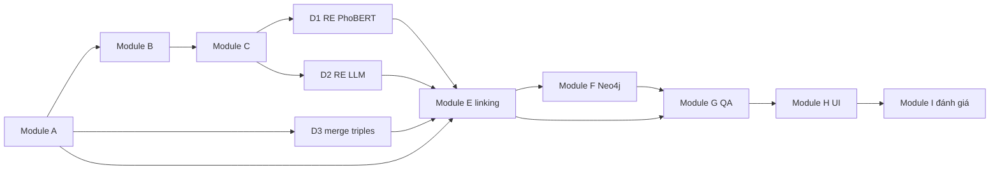

# 06 — Kế hoạch triển khai

## 1. Tổng thể: 12 tuần

```mermaid
gantt
    dateFormat YYYY-MM-DD
    title Kế hoạch triển khai đề tài (12 tuần)
    section Nền tảng
    Tuần 1  : Dựng repo, cấu hình, môi trường        :milestone, m1
    Tuần 1-2: A Thu thập & tiền xử lý                 :a
    section NER
    Tuần 2  : B1 B2 nhãn bạc + huấn luyện PhoBERT      :b
    section RE
    Tuần 3-4: C Coreference + D1 Wikidata DS          :c
    Tuần 4  : D1 D2 huấn luyện RE + LLM baseline       :d
    section KG
    Tuần 5  : E1-E4 Entity linking                    :e
    Tuần 6  : F Schema + nạp Neo4j                    :f
    section QA
    Tuần 7-8: G1-G4, G6, G8 Text-to-Cypher             :g
    section UI
    Tuần 8-9: H1-H4 Chat + đồ thị                     :h
    section Đánh giá
    Tuần 10 : I3 Gán nhãn gold                         :i
    Tuần 11 : I4, I5 Script đánh giá                   :j
    Tuần 12 : Báo cáo, demo, mở rộng                   :k
```

**Mốc bàn giao (milestone):**

| Mốc | Cuối tuần | Sản phẩm | Tiêu chí đạt |
|---|---|---|---|
| **M1** | 1 | Repo + cấu hình + môi trường chạy được | `docker compose up` mở Neo4j; backend health OK |
| **M2** | 2 | `documents.jsonl` (2.000–5.000 bài) | A1–A4 đạt AC |
| **M3** | 3 | Mô hình NER | NER F1 ≥ 0.85 trên dev |
| **M4** | 4 | Coreference + tập huấn luyện RE | Gold NER/RE đã gán ≥ 50% |
| **M5** | 5 | Mô hình RE + baseline LLM | RE F1 ≥ 0.70 |
| **M6** | 6 | Entity linking + KG nạp Neo4j | Linking ≥ 0.85; KG idempotent |
| **M7** | 8 | Text-to-Cypher chạy end-to-end | Exec accuracy ≥ 0.70 |
| **M8** | 9 | Giao diện web chat + đồ thị | H1–H4 đạt AC |
| **M9** | 11 | Bộ đánh giá + báo cáo số liệu | I3–I4 đạt AC (auto-gold đủ cỡ, script chạy 1 lệnh) |
| **M10** | 12 | Báo cáo + demo + phần mở rộng | Toàn bộ checklist nghiệm thu |

> **Cách thực thi chi tiết theo từng phase (dành cho AI tự làm và tự kiểm thử): xem [09-ke-hoach-thuc-thien.md](09-ke-hoach-thuc-thien.md)** — 15 phase (0–14), mỗi phase có Input/Output contract, lệnh kiểm thử và Gate.

> **Ghi chú chiến lược eval (11/2026):** ưu tiên **auto-gold từ Wikidata** (độc lập với mô hình) làm nguồn đánh giá chính; gán tay chỉ 100 câu tối thiểu để đối chiếu. Lý do và phương pháp: [07-danh-gia-va-kiem-thu.md](07-danh-gia-va-kiem-thu.md).
>
> **Ghi chú LLM (11/2026):** quota free tier Gemini + Groq chỉ ≈ 3.500 request/ngày, không đủ cho trích xuất toàn corpus (150k–400k câu) → bulk trích xuất chạy **model mở lượng tử hóa trên Kaggle GPU**; API free tier dành cho baseline tập con, Text-to-Cypher lúc demo và LLM-judge. Chi tiết: [05](05-du-lieu-va-nguon.md#84-mô-hình-llm-free-tier-tính-đến-112026).

---

## 2. Chi tiết theo tuần

### Tuần 1 — Nền tảng (M1)
- Dựng cấu trúc thư mục, `configs/*.yaml`, `.env.example`, `.gitignore`, `requirements.txt`.
- `docker-compose.yml` cho Neo4j (Community 5.x), tài khoản `neo4j` (ghi) + `reader` (API); cơ chế chỉ-đọc là session `READ_ACCESS` (Community không có RBAC).
- `docker-compose.yml` cho backend + frontend (dev mode).
- Backend FastAPI skeleton: `/api/health`, `/api/stats` giả lập.
- Frontend Vite + React + TS skeleton: trang chủ có ô chat trống.
- `src/common/`: config loader, logger, `set_seed`, chuẩn hóa tên/ngày.
- **Xác nhận**: Gemini key, Groq key, tài khoản Kaggle.

### Tuần 2 — Module A (M2)
- `scripts/download_dump.py` (tải dump + meta-current + redirects).
- `src/preprocess/filter_articles.py`: streaming parse, 4 tín hiệu lọc, `keep_reason`.
- `src/preprocess/clean_text.py`: bỏ template/bảng/ref/File/Thể loại; giữ hyperlink.
- `src/preprocess/split_sentences.py`: `pysbd` + `underthesea` (đoạn).
- `src/preprocess/parse_infobox.py`: parse infobox → dict + chuẩn hóa ngày + triple.
- Script thống kê: số bài, phân bố theo infobox type, kiểm tra AC A1–A4.

### Tuần 3 — Module B (M3)
- `src/ner/build_silver.py`: sinh nhãn bạc từ hyperlink.
- Báo cáo chất lượng nhãn bạc (rule baseline trên dev) → phải ≥ 0.60 F1.
- Notebook Kaggle `train_ner.ipynb`: fine-tune `vinai/phobert-base` token classification (BIOES), seed 42, split theo bài.
- Xuất `models/ner/` + báo cáo F1.
- `src/ner/infer_ner.py`: suy luận toàn bộ corpus → `ner_predictions.jsonl`.
- *Song song*: chuẩn bị Label Studio config + gán nhãn vài câu thử.

### Tuần 4 — Module C + D1 (M4)
- `src/coref/resolve_coref.py`: quy tắc đại từ trong đoạn + từ điển danh xưng + luật chủ thể bài.
- `src/coref/article_subject.py`: xác định chủ thể bài.
- `src/re/build_distant_supervision.py`: SPARQL Wikidata → cặp quan hệ; map property → quan hệ KG.
- `src/re/build_re_dataset.py`: ghép cặp + câu → `re_train.jsonl` (có nhãn `NA`).
- Notebook Kaggle `train_re.ipynb`: PhoBERT + entity marker, đánh giá F1 theo quan hệ.

### Tuần 5 — Module D1/D2/D3 (M5)
- `src/re/infer_re.py`: suy luận RE toàn corpus (Kaggle GPU) → `re_phobert.jsonl`.
- `src/re/infer_re_llm.py`: Gemini/Groq trích xuất theo schema JSON; kiểm tra evidence là substring.
- `src/re/merge_triples.py`: hợp nhất, loại trùng, giữ confidence cao nhất, gắn `alt_evidence`.
- `src/common/llm_client.py`: adapter Gemini + Groq, retry, rate limit, cache SQLite.
- Đánh giá RE F1 trên tập gold (đã gán ~125 câu).

### Tuần 6 — Module E + F (M6)
- `src/link/build_aliases.py`: tổng hợp alias từ infobox + hyperlink + Wikidata.
- Notebook Kaggle `embed_entities.ipynb`: BGE-M3 → `entity_embeddings.npy` + metadata.
- `src/link/link_mentions.py`: alias exact + embedding top-k + rerank theo ngữ cảnh.
- `src/graph/build_graph.py`: sinh nodes/edges → `graph.jsonl`.
- `src/graph/schema.cypher` + `scripts/load_neo4j.py` (MERGE, batch, idempotent).
- `scripts/validate_graph.py`: kiểm tra AC F1–F4.

### Tuần 7 — Module G phần lõi (M7)
- `backend/app/services/llm_client.py` (dùng chung adapter).
- `backend/app/services/neo4j_client.py`: driver, timeout, `LIMIT`, session `READ_ACCESS`.
- `backend/app/services/cypher_validator.py`: blacklist + kiểm tra `MATCH`/`LIMIT` + chặn `;`.
- `backend/app/services/entity_linker.py`: alias lookup từ `entities.jsonl`.
- `backend/app/prompts/text_to_cypher.txt`: schema + quan hệ hợp lệ + 8–12 few-shot.
- `POST /api/ask`: pipeline đầy đủ (linking → sinh → validate → execute → trả lời).
- Viết bộ câu hỏi test (40 câu) và đo exec accuracy.

### Tuần 8 — Module G nâng cao + UI khung (M7/M8)
- G5: vòng lặp tự sửa lỗi (tối đa 3 lần) + log.
- G7: sinh câu trả lời tự nhiên (chỉ dùng records).
- G8: 3 trạng thái `found` / `not_in_data` / `error`.
- Frontend: `ChatPanel`, `GraphView` (Cytoscape), `EvidencePanel`, `EntityCard`.
- `GET /api/search`, `GET /api/graph/{id}`, `GET /api/entity/{id}`.

### Tuần 9 — UI (M8)
- H2: màu theo loại node + legend + tương tác.
- H3: click node → thẻ thông tin + mở rộng láng giềng (≤ 30 node).
- H4: click edge → panel bằng chứng + link Wikipedia.
- H1: hiển thị Cypher (ẩn/hiện, copy), lịch sử hội thoại.
- Test hiệu năng render (NF-P5, NF-P6).

### Tuần 10 — Đánh giá: gán nhãn gold (M9)
- Gán 250 câu NER + 250 câu RE (2 người) + 150 mention linking.
- 50 câu chung → tính Cohen's kappa.
- Xuất JSONL chuẩn.
- Bổ sung 80 câu hỏi Text-to-Cypher + chạy Cypher chuẩn để sinh `expected_result`.

### Tuần 11 — Đánh giá + mở rộng (M9)
- `src/evaluation/evaluate.py`: NER F1, RE F1, linking accuracy, exec accuracy.
- Test tự động cho logic F1.
- Chạy đánh giá đầy đủ → `reports/`.
- Mở rộng (nếu có thời gian): B3 (chuẩn hóa thời gian), D5 (quan hệ có thời gian), H5 (lọc), H7 (timeline), I1 (thống kê).
- I5: chạy cấu hình không coreference / không linking để so sánh.

### Tuần 12 — Báo cáo & demo (M10)
- Viết báo cáo: đặt tả, phương pháp, kết quả, phân tích lỗi, hạn chế, hướng phát triển.
- Chốt số liệu đánh giá; kiểm tra toàn bộ checklist ở [02](02-requirements-phi-chuc-nang.md).
- Chuẩn bị demo: câu hỏi mẫu theo từng triều đại, dataset fixture nhỏ.
- Dọn dẹp repo, `.env.example`, README hướng dẫn chạy.

---

## 3. Phân công thành viên (gợi ý cho 3–4 người)

| Người | Phụ trách chính | Phụ trách phụ |
|---|---|---|
| **TV1** | Module A (dữ liệu), Module D1 (distant supervision), Wikidata | Module F (schema, loader) |
| **TV2** | Module B (NER), Module C (coreference), notebook Kaggle | Module D1 (mô hình RE) |
| **TV3** | Module E (linking), Module D2 (LLM baseline), Module D3 | Module B4 (so sánh LLM) |
| **TV4** | Module G (backend, Text-to-Cypher) | Module H (frontend), Module I |
| *(nếu 3 người)* | TV3 gộp E+G | TV4 gộp H+I |

**Quy tắc ghép đôi (pair programming) bắt buộc:**
- TV1 + TV2: chốt format artifact giữa A→B→C.
- TV2 + TV3: chốt định dạng mention/token offset giữa NER → RE → linking.
- TV3 + TV4: chốt interface `entity_id` giữa linking → Neo4j → API.

**Hợp đồng interface (bắt buộc, không đổi giữa các nhánh):**
- `entity_id`: `ent_<slug>_<hash8>`
- `document_id`: `doc_<page_id>`
- `sentence_id`: `s<page_id>_<para_idx>_<sent_idx>`
- Quan hệ: dùng đúng tên trong [04](04-schema-knowledge-graph.md)
- Artifact: JSONL, một record mỗi dòng, UTF-8, không BOM.

---

## 4. Dependency giữa các module



Điểm nghẽn cần chủ động xử lý sớm:
1. **Artifact giữa A và B** (chuẩn hóa câu, offset) — chốt ở cuối tuần 2.
2. **Mention giữa B/C và D/E** (offset theo ký tự, entity type) — chốt ở cuối tuần 3.
3. **`entity_id` giữa E và F/G** — chốt ở cuối tuần 6 (trước khi code frontend).

---

## 5. Rủi ro và kế hoạch dự phòng

| Rủi ro | Xác suất | Ảnh hưởng | Kế hoạch dự phòng |
|---|---|---|---|
| Tải dump quá chậm / bị gián đoạn | Trung bình | Trễ M2 | Dùng `wget -c`; nếu > 3 ngày thì chuyển sang xử lý trên Kaggle với dataset đã mount |
| Dữ liệu lịch sử trong Wikipedia tiếng Việt ít hơn kỳ vọng | Trung bình | Giảm số bài | Nới phạm vi: thêm các nhân vật chưa gắn triều đại, mở rộng BFS depth 3 |
| Wikidata SPARQL chậm / timeout | Trung bình | Trễ D1 | Chia nhỏ truy vấn theo triều đại; cache kết quả; fallback dùng infobox làm nguồn nhãn duy nhất |
| Quota Gemini/Groq quá thấp cho batch | Cao | Trễ D2 | Chia batch nhỏ; cache; ưu tiên dùng LLM cho *baseline* trên tập con 2.000 câu thay vì toàn bộ corpus; dùng Kaggle LLM 7B nếu cần |
| HuggingFace bị rate-limit tải mô hình | Thấp | Trễ B/D | Tải trước 1 lần, lưu vào `models/` và upload dataset lên Kaggle để dùng lại |
| NER F1 không đạt 0.85 | Trung bình | Ảnh hưởng uy tín | Báo cáo minh bạch; phân tích lỗi theo label; thử thêm: thêm nhãn từ Wikidata, mô hình lớn hơn, tăng nhãn bạc |
| RE F1 không đạt 0.70 | Trung bình | Ảnh hưởng uy tín | Thêm nguồn nhãn từ infobox + LLM distillation; nới ngưỡng confidence; báo cáo minh bạch |
| Linking accuracy không đạt 0.85 | Trung bình | Ảnh hưởng uy tín | Thêm reranker cross-encoder; mở rộng từ điển alias; dùng embedding tốt hơn |
| Thời gian nhóm bị hạn chế (điểm thiểu) | Cao | Ảnh hưởng điểm số | Cắt theo thứ tự: giảm số triều đại → giảm số bài → cắt phần mở rộng (B3/B4/D4-D5/H5-H7/I1/I5) |
| Neo4j chạy chậm trên máy yếu | Thấp | Ảnh hưởng demo | Đặt `dbms.memory.heap.max_size=1G`; giữ số cạnh ≤ 200k |
| 2 người gán nhãn lệch nhiều | Trung bình | Ảnh hưởng độ tin cậy | Dùng hướng dẫn gán nhãn chi tiết; calibration 20 câu trước; thảo luận chung |

---

## 6. Cổng kiểm soát (gate) — bắt buộc đạt trước khi sang tuần sau

| Cổng | Điều kiện |
|---|---|
| Tuần 2 → 3 | `documents.jsonl` có ≥ 2.000 bài; ≥ 90% bài có câu tách đúng; infobox parse OK |
| Tuần 3 → 4 | Nhãn bạc sinh cho ≥ 90% câu có link; baseline F1 ≥ 0.60; mô hình NER ≥ 0.85 |
| Tuần 4 → 5 | Tập `re_train.jsonl` ≥ 20.000 mẫu dương; gold NER/RE đã gán ≥ 50% |
| Tuần 5 → 6 | RE F1 ≥ 0.70 trên tập gold; ≥ 95% triple có đủ 6 trường bắt buộc |
| Tuần 6 → 7 | KG nạp idempotent; 0 cạnh thiếu bằng chứng; linking ≥ 0.85 |
| Tuần 7 → 8 | `/api/ask` chạy end-to-end; exec accuracy ≥ 0.60 (giai đoạn giữa) |
| Tuần 8 → 9 | 3 trạng thái phân biệt được; validator chặn 100% payload độc hại |
| Tuần 9 → 10 | UI chat + đồ thị + bằng chứng hoạt động; render 200 node < 1,5s |
| Tuần 10 → 11 | ≥ 200 câu NER + 200 câu RE + 150 mention đã gán; kappa đã tính |
| Tuần 11 → 12 | Tất cả chỉ số đã đo và lưu `reports/` |

---

## 7. Quy trình làm việc nhóm

1. **Mỗi task tương ứng 1 mục trong đặc tả** (`A1`, `D3`, …) — cập nhật trạng thái trong issue tracker (GitHub Issues trong repo).
2. **PR nhỏ**, mỗi PR gắn 1–2 mục yêu cầu; CI chạy test tự động.
3. **Hợp đồng interface** (mục 3) được ghi vào `docs/03-kien-truc-he-thong.md` và **không đổi giữa các PR**; đổi phải thông báo cả nhóm.
4. **Checkpoint Kaggle** lưu ra dataset riêng (`/kaggle/working/checkpoints`) và tải về `models/`.
5. **Mỗi cuối tuần**: cập nhật bảng tiến độ (module nào xong, số liệu hiện tại, vướng mắc).
6. **Mọi quyết định thay đổi phạm vi** phải ghi vào `docs/` (không chỉ trao đổi miệng).

---

## 8. Ưu tiên khi thiếu thời gian (nhắc lại)

Thứ tự cắt được chấp nhận:
1. Số triều đại: bỏ Tây Sơn / Hồ trước.
2. Số bài: 5.000 → 3.000 → 2.000.
3. Phần mở rộng: B3, B4, D4, D5, G5, G7, H5, H6, H7, I1, I5.
4. Phần "nếu còn thời gian": C3, D6, E6, G9, H8, H9, H10, I2.

**Không bao giờ cắt:** D3 (bằng chứng), F4, G4 (an toàn Cypher), G8 (không bịa), I3–I4 (đánh giá), E4 (QID + wiki_url).
