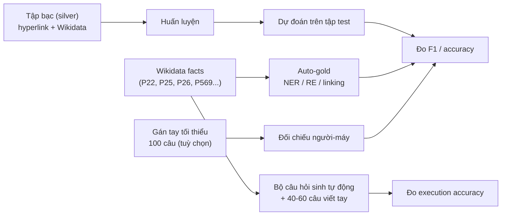

# 07 — Đánh giá và kiểm thử

## 1. Chiến lược đánh giá

**Chiến lược đã chốt (11/2026): ưu tiên auto-gold từ Wikidata, gán tay chỉ tối thiểu.**

Lý do: gán tay đầy đủ (250 câu × 2 người + kappa) tốn khoảng 1 tuần và rủi ro bị bỏ qua. Trong khi **Wikidata là nguồn đáp án độc lập với mô hình** → vẫn cho số liệu thật, tập lớn hơn nhiều, và không có vòng tròn.

| Tầng | Nguồn nhãn | Vai trò | Quy mô | Cần người? |
|---|---|---|---|---|
| **Silver** | Hyperlink Wikipedia, Wikidata | Huấn luyện | toàn corpus | Không |
| **Auto-gold** | Wikidata facts (độc lập với mô hình) | **Đánh giá chính** | NER ≥ 200 câu · RE ≥ 500 cặp · linking ≥ 300 mention | Không |
| **QA gold** | Sinh tự động từ Wikidata + 40–60 câu viết tay | Đánh giá Text-to-Cypher | 200–400 câu | Tối thiểu (viết tay) |
| **Manual** | 1–2 người gán | Đối chiếu người–máy | 100 câu | Có (tuỳ chọn) |

**Nguyên tắc không vòng tròn:** mọi đáp án trong auto-gold và QA gold đến từ **Wikidata**, không phải từ KG của chính mình. Nếu lấy `expected_result` từ KG mình thì đo lại độ đúng của KG → vô nghĩa.

**Nguyên tắc báo cáo:** số liệu chính thức lấy từ auto-gold + QA gold. Số liệu trên tập bạc chỉ dùng để theo dõi trong quá trình huấn luyện. Nếu một chỉ số không đạt mục tiêu → báo cáo số thực tế + phân tích lỗi, **không** sửa số liệu.

---

## 2. Quy trình gán nhãn (tùy chọn, chỉ 100 câu)

### 2.1. Quy trình rút gọn

1. **Hướng dẫn gán nhãn** (`docs/annotation-guidelines.md`): định nghĩa từng nhãn, ví dụ rõ/rõ, quy tắc khi nhãn mơ hồ.
2. **Chọn 100 câu có entity rõ nhất** (tự động: câu có ≥ 2 mention có QID) → gán nhanh, ít tranh cãi.
3. **Nếu có 2 người**: gán độc lập → tính agreement rate trên ≥ 30 câu chung; nếu đủ dữ liệu thì tính thêm Cohen's kappa.
4. **Nếu chỉ 1 người**: báo cáo **agreement rate giữa người và auto-gold** (đối chiếu người–máy), nêu rõ khác biệt với inter-annotator agreement.
5. Xuất JSONL chuẩn dùng cho script đánh giá.

### 2.2. Cohen's kappa (chỉ khi có 2 người gán)

- Dùng cho **NER**: đơn vị so sánh là *span* (không phải token) để tránh phồng độ thuận; báo cáo cả token-level agreement.
- Ngưỡng chấp nhận: **κ ≥ 0.60** (substantial agreement). Dưới 0.40 → phải viết lại hướng dẫn và gán lại.
- Báo cáo: κ tổng + κ theo từng nhãn.
- **Nếu không đủ điều kiện** → bỏ qua kappa, dùng agreement rate và nêu rõ lý do.

### 2.3. Cỡ mẫu

| Tập | Số lượng | Nguồn | Lý do |
|---|---|---|---|
| Auto-gold NER | ≥ 200 câu | Wikidata + hyperlink | ±0.05 ở F1 ≈ 0.85 → sai số ≈ ±3% |
| Auto-gold RE | ≥ 500 cặp | Wikidata | tương tự |
| Auto-gold linking | ≥ 300 mention | Wikidata QID | ±0.05 ở acc ≈ 0.85 |
| QA gold | 200–400 câu | sinh tự động + viết tay | ±0.06 ở acc ≈ 0.70 |
| Manual (tuỳ chọn) | 100 câu | 1–2 người | đối chiếu độc lập |

---

## 3. Định nghĩa chỉ số

### 3.1. NER — token-level P/R/F1

- Chuẩn hóa cả dự đoán và gold về **token** (theo khoảng trắng + dấu câu tiếng Việt).
- Dùng cơ chế **IOB2** để so sánh; span khớp hoàn toàn (cả biên và nhãn) mới tính là đúng.
- Báo cáo:
  - `micro` (tổng TP/FP/FN toàn tập) — **chỉ số chính**.
  - `macro` (trung bình theo nhãn) — để thấy nhãn yếu.
  - Breakdown theo từng nhãn trong bảng.
- Xử lý nhãn "O" (ngoài thực thể): tính vào số token nền, **không** báo cáo riêng F1 của "O" (vô nghĩa).

### 3.2. RE — P/R/F1 theo quan hệ

Cách tính (theo quan hệ `r`):
- **TP**: dự đoán đúng quan hệ `r` cho đúng cặp (subject, object) — tính theo **entity_id** (đã canonicalize), không theo chuỗi.
- **FP**: dự đoán `r` cho cặp sai, hoặc dự đoán quan hệ `r` khi gold là quan hệ khác.
- **FN**: bỏ sót triple có quan hệ `r`.
- Nhãn `NA` (không có quan hệ) **không** tính vào F1 của các quan hệ, nhưng được báo cáo riêng dưới dạng **tỉ lệ false positive**: số triple dự đoán quan hệ trong khi gold là `NA`.
- Báo cáo **micro-F1** (chính) + **macro-F1 theo quan hệ** + bảng P/R/F1 từng quan hệ.
- Báo cáo thêm 2 biến thể để phản ánh giá trị của coreference:
  - `RE (có coreference)` — chạy đầy đủ pipeline.
  - `RE (không coreference)` — bỏ bước C.
  - (đây chính là yêu cầu I5)

### 3.3. Entity linking

- **Accuracy**: tỉ lệ mention mà entity_id dự đoán đúng entity_id gold (chấp nhận cả khi gold = `NIL` và hệ thống dự đoán NIL).
- **MRR**: nếu gold chấp nhận nhiều đáp án.
- Báo cáo thêm:
  - **Alias hit rate**: tỉ lệ mention được giải quyết bằng chính xác từ điển alias (không cần embedding).
  - **Recall@k** của giai đoạn sinh ứng viên (k=20).
  - Phân tích lỗi theo nhóm: khác chữ, trùng tên, thực thể ngoài KB.

### 3.4. Text-to-Cypher

**Execution accuracy** (chỉ số chính):
- Chạy Cypher sinh ra trên Neo4j.
- Chạy `expected_cypher` (Cypher chuẩn) → `expected_result`.
- Đúng nếu **tập kết quả thỏa** (set of rows) khớp, so sánh không phân biệt thứ tự (trừ khi câu hỏi yêu cầu sắp xếp — khi đó so sánh có thứ tự).
- Chuẩn hóa giá trị: số → số (int/float không phân biệt kiểu), chuỗi → chuỗi đã trim.

**Nguồn `expected_result` (quan trọng — tránh vòng tròn):**
- Với bộ câu hỏi **sinh tự động** từ Wikidata: `expected_result` lấy từ **Wikidata**, không lấy từ KG mình.
- Với câu hỏi **viết tay**: chạy `expected_cypher` trên Neo4j để sinh `expected_result` → đây là ngoại lệ chấp nhận được vì Cypher chuẩn do người viết theo đặc tả schema, không phải do mô hình sinh.

Chỉ số phụ:
- **Syntax validity rate**: tỉ lệ Cypher parse được JSON + hợp lệ cú pháp.
- **Schema validity rate**: tỉ lệ Cypher chỉ dùng quan hệ trong danh mục.
- **Safety violation rate**: tỉ lệ Cypher bị validator chặn (mục tiêu: 0 trên bộ test hợp lệ).
- **Avg retries**: số lần retry trung bình.
- **Empty result rate**: tỉ lệ câu hỏi trả về rỗng.
- **Faithfulness**: tỉ lệ câu trả lời tự nhiên chỉ chứa thông tin có trong kết quả — đo bằng **LLM-judge** (Gemini/Groq) trên 30 câu + rà soát tay 10 câu. Mục tiêu ≥ 0.90.

Phân bố theo dạng: một bước / đa bước / đếm-liệt kê / so sánh-lọc / không có dữ liệu.

### 3.5. Đối chiếu người–máy (tùy chọn)

Nếu có gán tay 100 câu:
- **Quy tắc gán nhãn** theo [annotation-guidelines.md](annotation-guidelines.md) (bắt buộc đọc trước khi gán).
- **Agreement rate** = tỉ lệ span NER trùng khớp giữa nhãn người và auto-gold.
- Nếu có 2 người gán: thêm Cohen's kappa (mục 2.2).
- Báo cáo dạng bảng: auto-gold vs manual, theo từng nhãn — cho thấy độ tin cậy của auto-gold (tức là độ tin cậy của chính bộ đánh giá tự động).

---

## 4. Bộ kiểm thử tự động (unit + integration)

### 4.1. Unit test (chạy trong CI, không cần GPU)

| File | Nội dung |
|---|---|
| `tests/test_normalize.py` | chuẩn hóa tên (bỏ dấu), chuẩn hóa ngày Việt Nam, chuẩn hóa biểu thức thời gian |
| `tests/test_infobox.py` | parse 5 mẫu infobox thật → đúng key/value |
| `tests/test_clean_text.py` | bảo đảm không còn ký tự wiki; giữ hyperlink |
| `tests/test_sentence_split.py` | tách câu không vỡ tên có dấu phẩy |
| `tests/test_coref.py` | đại từ trong đoạn → đúng entity; luật chủ thể bài |
| `tests/test_relations.py` | chuẩn hóa quan hệ đối xứng; hợp nhất triple trùng |
| `tests/test_cypher_validator.py` | ≥ 20 payload độc hại bị chặn; Cypher hợp lệ được pass |
| `tests/test_metrics.py` | F1 tính đúng với dữ liệu mẫu đã biết kết quả |
| `tests/test_entity_id.py` | `entity_id` ổn định, không trùng |
| `tests/test_llm_client.py` | retry, fallback, cache (mock) |

### 4.2. Integration test

| File | Nội dung |
|---|---|
| `tests/test_loader_idempotent.py` | nạp fixture 2 lần → số node/cạnh không đổi |
| `tests/test_ask_pipeline.py` | `/api/ask` với câu hỏi mẫu + Cypher giả lập (mock LLM) → đúng trạng thái/response |
| `tests/test_graph_endpoints.py` | `/api/graph/{id}`, `/api/search`, `/api/entity/{id}` |
| `tests/test_graph_quality.py` | chạy `validate_graph.py` trên fixture → 0 lỗi |

### 4.3. Fixture

`tests/fixtures/` chứa ~10 bài Wikipedia đã xử lý + `graph.jsonl` + `entities.jsonl` nhỏ (50–100 node), đủ để chạy toàn bộ integration test trong < 10 giây mà không cần Neo4j thật (dùng driver mock hoặc Neo4j testcontainer).

---

## 5. Kịch bản kiểm thử thủ công (Manual test)

| # | Kịch bản | Kết quả mong đợi |
|---|---|---|
| 1 | Hỏi "Lê Lợi sinh năm nào?" | trả 1385 + Cypher + đồ thị 1 node |
| 2 | Hỏi "Lê Thái Tổ là ai?" | tìm đúng node Lê Lợi (alias) |
| 3 | Hỏi "Vợ của vua Lê Thái Tổ là con của ai?" | đa bước, trả đúng cha |
| 4 | Hỏi "Triều Trần có bao nhiêu vua?" | trả số đếm |
| 5 | Hỏi "Ai là vua năm 1855?" | "Không có trong dữ liệu" — **không bịa** |
| 6 | Click cạnh `cha_cua` | hiện câu bằng chứng + link Wikipedia |
| 7 | Click node → mở rộng láng giềng | thêm ≤ 30 node, màu đúng loại |
| 8 | Gõ "Bình Định Vương" vào ô tìm kiếm | gợi ý "Lê Lợi" |
| 9 | Gửi câu hỏi chứa `MATCH (n) DETACH DELETE n` (qua API) | bị chặn, trả lỗi thân thiện |
| 10 | Ngắt mạng giữa chừng | UI báo lỗi rõ ràng, không trắng |
| 11 | Nạp lại KG lần 2 | số node/cạnh không đổi |
| 12 | Click "Xem Cypher" | hiện Cypher, copy được |

---

## 6. Checklist nghiệm thu cuối cùng

### Chức năng
- [ ] A1–A5: dữ liệu tải được, lọc đúng phạm vi, sạch, tách câu, infobox trích đủ
- [ ] B1–B2: 6 lớp entity; nhãn bạc sinh được; NER ≥ 0.85
- [ ] C1–C2: đại từ gắn đúng; chủ thể bài xác định ≥ 90%
- [ ] D1–D3: RE ≥ 0.70; 100% triple có 6 trường bắt buộc
- [ ] E1–E4: alias đầy đủ; linking ≥ 0.85; `entity_id` + QID + wiki_url
- [ ] F1–F4: schema đúng; nạp idempotent; index/constraint có; mọi cạnh có bằng chứng
- [ ] G1–G4, G6, G8: hỏi đáp chạy; Cypher chỉ đọc; exec accuracy ≥ 0.70; không bịa
- [ ] H1–H4: chat + đồ thị + bằng chứng hoạt động
- [ ] I3–I4: bộ đánh giá (auto-gold + QA gold) đủ cỡ; script đánh giá chạy một lệnh

### Phi chức năng
- [ ] Truy vấn Cypher p95 < 2s
- [ ] End-to-end p50 < 10s trên máy i3
- [ ] 100% payload độc hại bị chặn
- [ ] Pipeline chạy lại cho kết quả giống hệt (seed cố định)
- [ ] Không có secret trong repo; `.env.example` đầy đủ
- [ ] Docker Compose dựng được từ máy sạch
- [ ] Mọi entity có `wiki_url` (CC BY-SA)

### Báo cáo
- [ ] Mô tả phương pháp chi tiết từng module
- [ ] Bảng kết quả đánh giá với kích thước tập
- [ ] Phân tích lỗi theo label/loại câu hỏi
- [ ] Cohen's kappa **hoặc** agreement rate người–máy (tuỳ có gán tay hay không)
- [ ] So sánh cấu hình (có/không coreference, có/không linking)
- [ ] Phần giới hạn và hướng phát triển
- [ ] Đoạn ghi nguồn và giấy phép

---

## 7. Bảng theo dõi chỉ số (điền dần theo tuần)

| Chỉ số | Mục tiêu | Tuần 3 | Tuần 5 | Tuần 6 | Tuần 8 | Tuần 11 | Kết quả cuối |
|---|---|---|---|---|---|---|---|
| NER F1 (dev) | ≥ 0.85 | | | | | | |
| NER F1 (auto-gold) | ≥ 0.85 | | | | | | |
| RE F1 (auto-gold) | ≥ 0.70 | | | | | | |
| Linking acc (auto-gold, theo QID) | ≥ 0.85 | | | | | | |
| Exec accuracy (QA gold) | ≥ 0.70 | | | | | | |
| Faithfulness (không bịa) | ≥ 0.90 | | | | | | |
| Agreement người–máy (nếu có gán tay) | ≥ 0.85 | | | | | | |
| Số node | 5k–30k | | | | | | |
| Số cạnh | 50k–200k | | | | | | |
| % cạnh có bằng chứng | 100% | | | | | | |
| Cypher p95 (s) | < 2 | | | | | | |
| E2E p50 (s) | < 10 | | | | | | |

---

## 8. Quy trình báo cáo kết quả

1. Chạy `python scripts/evaluate.py --all` → sinh `reports/eval_<timestamp>.json` + `.md`.
2. Đính kèm bảng chỉ số vào báo cáo, **luôn kèm kích thước tập đánh giá**.
3. Kèm phân tích lỗi: top 20 lỗi NER/RE với ví dụ cụ thể và nguyên nhân.
4. Kèm kappa của tập gold.
5. Nếu chỉ số không đạt mục tiêu → ghi rõ số thực tế + phân tích nguyên nhân + hướng khắc phục (không che giấu).
